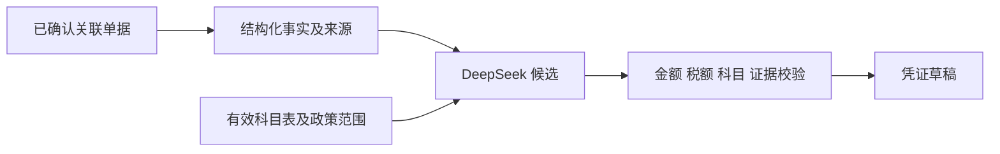

# 凭证候选的判断边界

这次功能的关键是把“事实”和“建议”分开：已确认单据和核对结果提供事实；DeepSeek 依据事实与政策提出分录；后端验证候选后才保存草稿。

## 可运行的理解阶梯

1. 保存允许科目范围；观察政策版本和旧草稿清理。
2. 用含“办公费用”用途的支付证明、发票和银行回单重新核对；观察模型输入包含每份单据的字段与来源。
3. 用模拟模型分别选允许范围内、范围外科目；观察前者生成草稿、后者返回 422。

下一步可在真实 API 模式的“业务会计政策”页面选择一组允许科目，保存后到业务中心重新核对并查看凭证候选。浏览器自动化对应 `apps/web/e2e/purchase-workflow.spec.ts` 的“财务确认费用政策后”用例。
